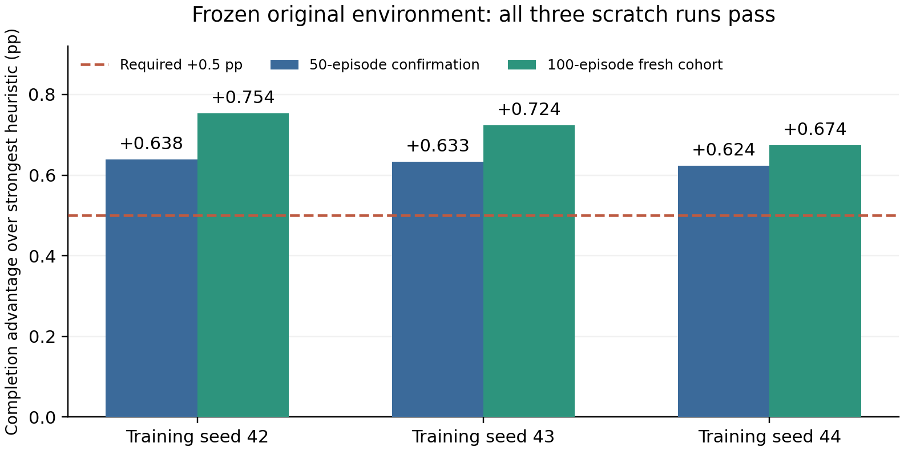

# UAV-SFC 原固定环境最终验证（2026-10-21）

**结论：按本聊天约定门槛达标，三个独立训练种子42/43/44均通过50集确认和新100集复核。**

最小完成率优势为0.623504个百分点，超过0.5门槛；全部学习模型0%观测坠毁、平均回报高于各自同批最强对照。

## 同环境实测

原完整`heterogeneous_hybrid`：每UE每slot泊松均值λ=.5（非伯努利概率）、500MHz CPU、4UAV/20UE/M12/K6/40步，原奖励/电池/碰撞/带宽。以完整flatten字典manifest逐项核对，未通过改变环境提高分数。

确认种子91000–91049，各策略50集；最终复核92000–92099，各策略100集。三个训练种子使用匹配的评估种子，各种子内episode独立，不能把它们称为450个不同环境种子。每组独立比较学习、静态全状态零移动、全状态、仅观测启发式；最强均为静态对照。三个模型的全部基线指标完全相同（数值漂移记录为空）。

|训练种子|批次|学习完成率%|最强对照%|优势/百分点|学习坠毁率%|学习回报|对照回报|
|---|---|---:|---:|---:|---:|---:|---:|
|42|50集确认|53.965483|53.327015|+0.638468|0.0|665.885330|656.571395|
|42|100集复核|53.527489|52.773826|+0.753662|0.0|659.791224|648.971688|
|43|50集确认|53.960495|53.327015|+0.633480|0.0|665.876632|656.571395|
|43|100集复核|53.497542|52.773826|+0.723715|0.0|659.477768|648.971688|
|44|50集确认|53.950519|53.327015|+0.623504|0.0|665.798248|656.571395|
|44|100集复核|53.447630|52.773826|+0.673804|0.0|658.743377|648.971688|

## 100集复核的能耗、存活和时延

|策略|完成率%|坠毁率%|回报|能耗J/step|平均存活步|完成时延s|
|---|---:|---:|---:|---:|---:|---:|
|学习seed42|53.527489|0.0|659.7912|766.6738|40.00|2.437876|
|学习seed43|53.497542|0.0|659.4778|766.5880|40.00|2.428489|
|学习seed44|53.447630|0.0|658.7434|766.3712|40.00|2.434055|
|静态全状态零移动|52.773826|0.0|648.9717|765.8814|40.00|2.428619|
|全状态启发式|49.599516|12.0|595.4431|2621.2756|39.61|2.457750|
|仅观测启发式|48.633246|13.0|580.6751|2724.6778|39.57|2.400882|

学习组取得完成率/回报优势，但能耗与完成时延略高于静态对照；不宣称这些代价指标全部改善。0%为实测范围内的观测坠毁率，不是对所有未来场景的绝对安全保证。

## 算法与独立训练

算法是从现有observation构造8套完整部署方案，由学习评分网络选一整套。推理不读取env内部、未来或在线模拟器。运动是共享解析速度制动，本结果不声称学习了运动；此前扩散方法的失败结果保留。训练标签使用反事实模拟，模拟成本单独报告。

每个训练种子随机初始化、独立1000训练episodes，数据种子分别650000/660000/670000段。每模型40,000真实训练交互、320,000反事实仿真步；80%训练、20%完整episode留出，50epochs/12,500更新，用留出reward-regret选epoch，固定验证18000–18019的20集选五档margin。不是旧权重续训、不是共享训练数据的伪独立复现。

|训练种子|实际本地run id|所选epoch|margin|模型SHA256|
|---|---|---:|---:|---|
|42|7c9be187|14|0.05|1b26b5f4d658bfc30d148fb159f3aec70dcf6c5e2170c05ee816e5c60bc3ad0e|
|43|0b2c75ef|12|0.0|f26458cd5f4f2b6d9e3acbaeff00c7332e171f7b9a6578ebaa34fd4af1786fa0|
|44|176580e8|20|0.05|ad8bdb9fd65b09ac18603d741f458b8619641e2f898f17b174d80a810fb87ad7|

本批三模型训练数据成本合计120,000真实交互+960,000反事实步。验证选margin/50集确认/100集复核另计2,100个评估episode、83,652个真实环境步；不把额外仿真隐去，也不把此前失败探索与smoke算作本批训练。

所有本批模型均在本地Python3.10.19/Torch2.11.0+cpu/NumPy2.2.6训练，显式选择CPU。SSH暂不可用时没有重启服务器作业；旧GPU批运行时不同，早期250集模型42曾在GPU训练，这些旧结果不能混入本批同协议达标。W&B尚未发布，本地run id不冒充在线run。

科学版本：seed42源6abaf00379889d055415af97306c8507b7e7920f；43/44源6d06e6024c07a3c0c212493ac6fe57e4ba030462。后者只改善控制/审计，部署推理、网络、训练数学和完整环境保持一致。

## 可复核交付

- `experiments/server_20261021/scorer_scale1000_final_audit.json`：完整哈希/metadata/配置/独立数据/epoch/margin/目标与成本审计，all_requirements_pass=true。
- `experiments/server_20261021/scorer_final_release.zip`：三个模型、固定配置、科学源快照、审计和推理/复核说明；默认seed42是在复现前冻结的模型，没有测试后择优换seed。
- `experiments/server_20261021/scorer_scale1000_seed42_evidence.tar`、`scorer_scale1000_replicates_43_44_evidence.tar`：完整数据、模型、状态、各策略JSON、stdout/stderr和耗时，tar逐文件哈希回读已核验。
- `docs/stationary_continuation_2026-10-21.md`：完整失败—诊断—改动—复核历史。此前250集43/44复现失败仍保留，未删除或改写为成功。
